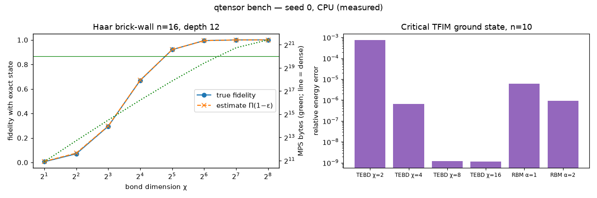

# Q-Tensor-RBM: MPS simulation of qudit chains, plus RBM neural quantum states

[](https://github.com/Cyb0rg137ms/Quantum_tensor_rbm/actions/workflows/ci.yml)

[](LICENSE)

A small, tested NumPy library for d-level quantum chains: MPS with exact truncation accounting, TEBD, and a Carleo–Troyer RBM, each checked against exact references.



*Figure: rendered by `python scripts/plot_bench.py` from [`docs/assets/bench.json`](docs/assets/bench.json), the raw output of `qtensor bench --seed 0 --json docs/assets/bench.json` (CPU, about 7 s).*

## Why it matters

Tensor-network simulators are easy to oversell: v1 of this repo claimed volume-law entanglement in linear memory while its gate function never applied the gate. This version implements real MPS/TEBD and RBM physics, checks every result against a dense state vector or exact diagonalisation, and **measures where MPS simulation breaks down** as well as where it succeeds.

## Key results

**Correctness.** Untruncated MPS against the dense state vector on random Haar circuits that include non-adjacent
gates:

| n | d | gates | fidelity | max entropy error |
|---|---|---|---|---|
| 10 | 2 | 60 | 0.999999999999994 | 9.8e-15 |
| 6 | 3 | 40 | 0.999999999999997 | 4.0e-15 |

**Low entanglement is cheap.** A qudit GHZ state with d=10 is exact at χ = d, and every bond carries exactly ln d:

| n | seconds | MPS bytes | dense state would need |
|---|---|---|---|
| 10 | 0.002 | 131,200 | 10^11.2 B |
| 100 | 0.018 | 1,571,200 | 10^101.2 B |
| 1000 | 0.19 | 15,971,200 | 10^1001.2 B |

**High entanglement is not cheap.** A Haar brick-wall circuit with n=16 and depth 12, compared with the exact state
(dense size 1,048,576 B):

| χ | true fidelity | estimate Π(1−ε) | mid-chain S | seconds | MPS bytes |
|---|---|---|---|---|---|
| 2 | 0.0059 | 0.0079 | 0.509 | 0.010 | 1,920 |
| 8 | 0.2957 | 0.2975 | 1.753 | 0.016 | 23,168 |
| 16 | 0.6698 | 0.6714 | 2.356 | 0.021 | 76,416 |
| 32 | 0.9204 | 0.9207 | 2.822 | 0.043 | 240,256 |
| 64 | 0.9944 | 0.9944 | 3.043 | 0.173 | 699,008 |
| 256 | 1.0000 | 1.0000 | 3.079 | 0.413 | 2,796,160 |

The discarded-weight estimate tracks the true fidelity closely. Near-exact simulation needs an MPS *larger* than the
dense vector, which is the volume-law wall.

**Ground state.** Critical TFIM, n=10, J=h=1, exact E₀ = −12.3814899997:

| method | energy | rel. error | seconds |
|---|---|---|---|
| imaginary-time TEBD, χ=2 | −12.3721291107 | 7.6e-4 | 0.23 |
| imaginary-time TEBD, χ=4 | −12.3814818996 | 6.5e-7 | 0.23 |
| imaginary-time TEBD, χ=8 | −12.3814899850 | 1.2e-9 (Trotter floor) | 0.26 |
| RBM α=1, 120 params | −12.3814155921 | 6.0e-6 | 1.40 |
| RBM α=2, 230 params | −12.3814788218 | 9.0e-7 | 2.30 |

Reproduce:

```bash
pip install -e ".[dev]"
qtensor bench --seed 0 --json docs/assets/bench.json
python scripts/plot_bench.py docs/assets/bench.json docs/assets/bench.png
```

## Architecture

```mermaid
flowchart LR
    G[qtensor.gates<br/>DFT, shift, clock, CSUM, SWAP, Haar] --> M
    G --> S
    subgraph MPS engine
      M[qtensor.mps.MPS] -->|move_center: QR sweeps| C[mixed-canonical form]
      C -->|theta = A_i A_i+1, apply gate| SVD[SVD + truncate chi / cutoff]
      SVD -->|discarded weight eps| T[TruncationStats<br/>fidelity ≈ Π(1-eps)]
      SVD --> M
    end
    S[qtensor.statevector<br/>dense reference] -->|tests: fidelity, entropies| M
    H[qtensor.models.TFIM] -->|bond terms| TE[tebd: 2nd-order Trotter<br/>real / imaginary time]
    TE --> M
    H -->|dense H| ED[exact diagonalisation]
    H -->|dense H| R[qtensor.rbm: RBM ansatz<br/>exact-enumeration SR]
    ED -->|reference E0| B[benchmarks / CLI]
    R --> B
    M --> B
```

More diagrams: [docs/ARCHITECTURE.md](docs/ARCHITECTURE.md).

## 60-second quickstart

```bash
pip install -e ".[dev]"
qtensor bench            # every table above (about 7 s on CPU)
qtensor ghz --n 1000 --d 10
python examples/bell_state.py
pytest
```

## Usage

```python
import numpy as np
from qtensor import MPS, dft, csum, haar_unitary

psi = MPS(n=50, d=3, max_bond=32)
psi.apply_1site(dft(3), 0)
for i in range(49):
    psi.apply_2site(csum(3), i)  # qutrit GHZ, exact at chi = 3
psi.apply_2site(haar_unitary(9, np.random.default_rng(0)), 0, 7)  # non-adjacent, routed by SWAPs
print(psi.entropies()[:3], psi.stats.fidelity_estimate, psi.sample(4, np.random.default_rng(1)))
```

v1 compatibility: `from simulator import MultiStateQuantumSimulator, ...` still works, and all 16 original tests pass unchanged.
`apply_two_state_gate` now really applies the gate; it defaults to `CSUM·(DFT⊗I)` when no gate is given.
`calculate_reconstructed_entropy` returns the sum of the true bond entropies.

v1's `benchmark.py` imported a function that did not exist, and `BENCHMARK_RESULTS.md` contained no measurements. Both
were removed.

## Design decisions and trade-offs

- **Mixed-canonical MPS with optimal SVD truncation** and exact discarded-weight tracking, so `stats.fidelity_estimate` is a cheap, honest error bar (it tracks true fidelity in the brick-wall table).
- **Non-adjacent gates routed by SWAPs**: simple and exact, but each hop costs a two-site update.
- **Second-order Trotter TEBD** for ground states instead of DMRG: less code, with a Trotter floor near 1e-9.
- **RBM trained by exact enumeration**: a validated reference for n ≲ 16, not a scalable VMC sampler.
- **NumPy + LAPACK only**, no GPU backend, to keep the library small and portable.

## Limitations and roadmap

- MPS cost grows with entanglement; generic deep circuits are not simulated efficiently.
- RBM uses exact enumeration (n ≲ 16) and real parameters.
- 1-D open chains only; no PEPS, periodic boundaries or DMRG.
- CPU / NumPy only.

Roadmap: MPO/DMRG ground states, a Metropolis sampler for the RBM, and complex RBM parameters.

Full list: [docs/LIMITATIONS.md](docs/LIMITATIONS.md).

## Citation

```bibtex
@software{qtensorrbm2026,
  author = {Cyb0rg137ms},
  title  = {Q-Tensor-RBM: MPS simulation of qudit chains, plus RBM neural quantum states},
  year   = {2026},
  url    = {https://github.com/Cyb0rg137ms/Quantum_tensor_rbm}
}
```

## License

MIT, see [LICENSE](LICENSE).
